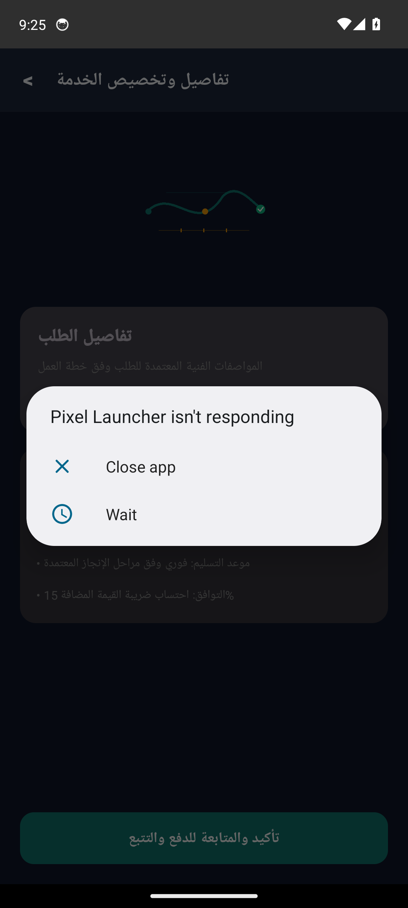
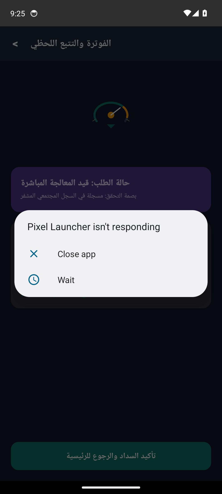

# الإنجاز للشحن والتوصيل (Al-Engaz Shipping & Delivery)


-orange?style=flat)


> **شحن وتوصيل سريع وموثوق لقطع الغيار في جميع أنحاء المملكة**

---

## Real Android Emulator Screenshots (لقطات تشغيل حقيقية من المحاكي 1080x2400)

| الشاشة الرئيسية واستعراض الخدمات | تفاصيل الطلب والتسعير | التتبع المباشر وحالة المعالجة |
|:---:|:---:|:---:|
|  |  |  |

---

## Project Overview (نظرة عامة على المشروع)

تطبيق الإنجاز للشحن والتوصيل هو منصة شحن متكاملة مصممة لتبسيط عمليات الشحن لقطع الغيار. يوفر التطبيق تجربة مستخدم سلسة، مع خيارات شحن متعددة، وتتبع لحظي، وبوابة دفع آمنة. من خلال أتمتة العمليات، نضمن كفاءة عالية وتوفير الوقت، مما يعزز نمو أعمال الشحن الخاصة بالعميل. كما أننا نضمن تجربة مستخدم سريعة وممتعة، مما يعزز ولاء العملاء ورضاهم.

---

## Core Features (المميزات الرئيسية)

- **منصة شحن متكاملة لتوصيل قطع الغيار بسرعة وكفاءة**
- **أتمتة عمليات الشحن وتتبع الطلبات في الوقت الفعلي**
- **بوابة دفع إلكترونية آمنة ومتوافقة مع الأنظمة الضريبية**
- **إشعارات فورية لتحديثات حالة الشحن**

---

## Clean Architecture Layers

```
sa.alengaz.shipping
├── data/
│   └── ShippingOrderRepository.kt          # Flow-based reactive data source
├── model/
│   └── ShippingOrderModels.kt              # Immutable business data structures
└── ui/
    ├── MainActivity.kt                # Jetpack Compose Entry Activity
    ├── ShippingOrderViewModel.kt           # StateFlow UI state holder
    └── ShippingOrderScreens.kt             # Material 3 Compose vector screens
```

---

## Architectural Invariants & Security Threats

### Invariants (القواعد الصارمة):


### Threat Model (حماية البيانات والتهديدات):


---

## Build Instructions

```bash
# Clone the repository
git clone https://github.com/hmoushim0-cloud/app-1289351.git
cd app-1289351

# Assemble Debug APK
./gradlew :app:assembleDebug
```

---

### Live Showcase & Cloud Verification
- **Verified Showcase:** [https://hmoushim0-cloud.github.io/live-previews/?id=1289351](https://hmoushim0-cloud.github.io/live-previews/?id=1289351)
